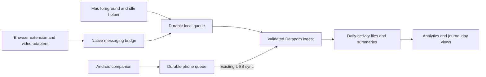

# Device activity and video analytics — proposal

Status: custom collector proposal deferred. The user chose to improve the existing RescueTime integration first. Full activity imports, an hourly day explorer, and provider-supplied page/document details are implemented; no custom collector or browser extension is enabled. The replacement design below remains a future option, not the current implementation scope.

Confirmed scope: Mac + Android, with Chrome or another Chromium browser. Save
page titles and URLs, plus video titles and watch time. Use Chrome on Mac as the
initial validation target; the exact Android browser and video-site list remain
to be selected. URL storage uses the sanitization rules below.

## Recommendation

Add a local Datapom activity collector, a browser extension, and an Activity
view inside Digital analytics. Keep collection running independently of the
journal window. Reuse the Android companion for phone collection and its USB
sync path. The target is a complete replacement of this app's live RescueTime
integration: Datapom collects activity and computes productivity locally, with
no RescueTime account, agent, API key, or calls to its servers required. Preserve
already-imported RescueTime history as a read-only legacy source. Spotify remains
its own integration.

This is an ongoing collection feature: historical summaries can be displayed,
but they cannot reconstruct past page visits or video playback sessions.

## What the current code already supports

- `rescuetime.py` fetches per-app/website daily activity and productivity;
  `parse_activities` now retains all reported activities and fractional minutes; older imports may still be capped until refreshed. `provider_sync.py`
  reconciles this into journal entries. Digital → Productivity renders it.
- Android `UsageReader.kt` records foreground app minutes, foreground-resume
  counts, unlocks, and first/last use. It retains eight apps per day.
  `UsagePushWorker.kt` currently sends the last three completed days, excluding
  today. `usage.py` and Digital → Phone usage consume these summaries.
- Neither source provides the detailed video playback history proposed here.
- `app.py` shuts down the dock-launched server shortly after the last Datapom
  tab closes. A collector hosted only inside Flask or the journal page would
  miss activity while the app is closed.
- Analytics already has grouped navigation, date filters, an SVG chart registry,
  mood/sleep/task data, and Patterns views. The location feature supplies a useful
  precedent for daily files and loading detail only when needed.

## Capture scope and limits

| Source | Proposed capture | Limits and setup |
| --- | --- | --- |
| Mac apps | App name and stable bundle ID; foreground sessions; idle, sleep, and lock boundaries | Small login helper. Running in the background does not count as foreground use. Window/document titles are outside the default scope. |
| Mac browser | Domain, page title, sanitized URL, focused-tab intervals, visits and browser/profile source | Extension installed separately in each supported browser/profile. Capture depends on browser permissions and excludes private browsing. |
| Browser videos | Site, stable video ID/canonical link where available, title/channel where available, playback intervals, foreground/background/PiP state, playback rate | Initial target: YouTube plus generic HTML video on explicitly enabled sites. Site-specific adapters, including Bilibili if wanted, require separate verification. Protected/embedded players may expose only partial metadata. |
| Android apps | All observed apps, daily totals, today-to-date data, foreground sessions where supported, unlocks | Extend existing usage access and durable local storage; transfer through existing USB sync. Mac analytics refreshes after a sync. |
| Android media | Optional media title and reported playback state from cooperating apps | Separate notification-access opt-in; app-dependent metadata. Report observed playback, not verified attention or guaranteed video identity. |
| Android websites | App-level browser time initially | Usage access does not provide a universal page-history feed. Chrome's desktop extension cannot run in Android Chrome; detailed sites need a separately supported mobile-browser adapter. |

Apple exposes foreground-app and application-activation APIs, and an elapsed
input-idle API. These are the proposed Mac primitives; the first engineering
step must verify permission behavior on the installed macOS version rather than
promise a permission-free install. [NSWorkspace](https://developer.apple.com/documentation/appkit/nsworkspace),
[idle time](https://developer.apple.com/documentation/coregraphics/cgeventsource/secondssincelasteventtype(_:eventtype:)).

Chrome distinguishes an active tab from a focused window and requires permission
for URL/title access. Automatic tracking must combine browser focus with the Mac
foreground source. [Tabs API](https://developer.chrome.com/docs/extensions/reference/api/tabs).
Android usage events have limited system retention, so local periodic capture
must happen independently of USB connection. Background restrictions can still
cause gaps. [UsageStatsManager](https://developer.android.com/reference/android/app/usage/UsageStatsManager).
The Android media adapter depends on an enabled notification listener.
[MediaSessionManager](https://developer.android.com/reference/android/media/session/MediaSessionManager).
Google documents desktop-only extension support for Chrome.
[Chrome extension compatibility](https://support.google.com/chrome_webstore/answer/1698338).

**Android page-detail decision:** the requested titles/URLs require a separate
browser integration. In the first feasibility stage, evaluate an extension-capable
Chromium browser on the actual phone: verify installation, tabs/host APIs,
video events, durable buffering, and a supported local/USB delivery path. Do not
assume desktop native messaging exists on Android. If that path works, add a
mobile extension adapter to stage 4. If the chosen browser remains Android
Chrome, full automatic page-title/URL coverage is an unresolved requirement;
app totals and partial media metadata do not satisfy it. Bring that tradeoff
back for a browser/scope decision before committing to full coverage. Reading
arbitrary on-screen content through Accessibility is not the default solution.

## Counting rules

1. **Foreground use:** count the foreground app while unlocked and not idle.
   Propose a configurable two-minute idle threshold. Confirmed visible video
   playback can continue the foreground estimate during hands-free viewing;
   label this as observed activity, not proof the user is watching.
2. **Websites are part of browser time:** a website refines a browser interval.
   It never contributes extra time on top of that interval. Unmatched browser
   intervals remain “Browser — site unavailable.”
3. **Video is an overlapping layer:** 30 minutes watching a video produces
   30 device minutes, 30 browser minutes, 30 website minutes, and 30 playback
   minutes. Those are different views of the same period, not 120 minutes.
4. **Measure playback:** use play/pause/playing/waiting/seeking/ended signals
   and bounded progress observations. Pauses, buffering, and seek jumps do not
   become watched time. Ten wall-clock minutes at 2× speed remain ten minutes of
   playback, with content progress available separately. Generic browser media
   events supply the base signals; title/identity are adapter concerns.
   [Media playing events](https://developer.mozilla.org/en-US/docs/Web/API/HTMLMediaElement/playing_event).
5. **Background and PiP:** preserve their flags and show playback separately
   from foreground browsing. A background video does not convert an otherwise
   idle device into active use. Deduplicate duplicate observations of one
   player; mark overlapping players and avoid presenting their sum as elapsed
   viewing time. No completion percentage for live streams or unknown lengths.
6. **Several devices:** show per-device totals by default. When summing them,
   call the result “device time.” Only offer unique elapsed time for sources
   with sufficiently complete timestamped intervals; old phone/RescueTime
   summaries cannot support that calculation.
7. **No double import:** receipt IDs make retries idempotent. RescueTime's
   aggregate history never adds to native tracking on the same device/day.
   Keep its productivity score and legacy totals explicitly source-labeled.
8. **Missing is unknown:** distinguish observed zero, paused tracking, permission
   denied, not yet synced, collector stopped, and partial coverage. Retain full
   per-app/domain data; top-N limits belong in the display only.

## Proposed analytics experience

Digital navigation becomes:

`Activity · Websites · Videos · Productivity · Music · Phone usage`

Keep tabs visible before setup, with useful connection instructions in their
empty states. Preserve existing tab IDs and links.

| View | Content |
| --- | --- |
| Activity | Per-device activity cards, daily stacked totals, app rankings, app/site switches, hourly heatmap, and an expandable single-day timeline with idle/gap markers. |
| Websites | Domains ranked by active time, visit/session counts, daily trends, editable categories, and searchable page history with captured titles and URLs. Domain drill-down opens the relevant page sessions. |
| Videos | Foreground and background playback totals, history grouped by video, title/channel/site where available, repeated sessions, and timeline drill-down. Distinguish titled videos from unknown players. |
| Productivity | Datapom-owned categories, productive/neutral/distracting/unrated time, productive share, and sustained work sessions. Previously imported RescueTime scores remain explicitly labeled historical data. |
| Phone usage | Existing unlocks/app charts remain; retain access to legacy summaries and show source freshness. New app detail links to the shared Activity view. |
| Patterns | Add late-evening activity ↔ next-night sleep, video time ↔ mood, and categorized work time ↔ task completions. Show paired-day count and coverage; describe associations rather than causes. |

Activity layout, using the current dark amber/monospace components:

```text
Digital
[Activity] Websites  Videos  Productivity  Music  Phone usage

[Last 7 days]   [Mac / Phone / All]   [All categories]
Mac: tracking · synced recently     Phone: last synced …

[Mac foreground time] [Phone app time] [Video playback] [Coverage]

Daily activity                    Most-used apps
[stacked day bars]                [ranked horizontal bars]

When activity happens             Selected day
[hour × weekday heatmap]          [Open day → journal]

Day detail
Mac apps    ── Editor ── Browser ── gap ──
Websites               Docs / YouTube
Playback                    Video title …
Phone       ── Messaging ──
```

Click an app/domain/video to filter the day and range views. Click a day to open
its journal entry. Add a compact read-only activity row on entries; collecting
activity does not create a written journal entry or overwrite entry content.
Optional classification rules use app/domain/video overrides, unrated defaults,
and existing tags where explicitly assigned. Watching a tutorial does not
automatically make all YouTube usage productive.

Use existing `.analytics-panel*`, `.section-filter`, themed dropdowns,
`confirmModal`, legends, `CHARTS`, and SVG utilities. New classes get theme-based
CSS. No charting libraries or remote thumbnails/fonts are needed.

## Collection and storage architecture



- **Mac helper:** small Swift executable launched for this user at login. Listen
  for app/session changes, use a low-frequency idle/liveness check, and close
  intervals on sleep/lock. Include pause/resume/status and uninstall support.
  Do not require the journal window or Flask to stay open.
- **Browser extension:** Manifest V3, vanilla JavaScript, durable local pending
  state. Use tabs/focus events for sites and content scripts only on approved
  video hosts. Use native messaging with an exact extension-ID allowlist to
  reach the helper through a private local IPC channel. Browser profiles have
  distinct source IDs. Chrome can terminate extension workers; recovery must
  revalidate state rather than assume an in-memory timer kept running.
  [Native messaging](https://developer.chrome.com/docs/extensions/develop/concepts/native-messaging),
  [worker lifecycle](https://developer.chrome.com/docs/extensions/develop/concepts/service-workers/lifecycle).
- **Queue and delivery:** atomically persist bounded batches before delivery.
  Retry while Datapom is unavailable; ingest when it next runs. Collector requests
  do not register as browser heartbeats. Acknowledgements list durable receipt
  IDs; remove acknowledged batches only. Surface queue age/storage pressure.
  Crash or heartbeat gaps end at the last confirmed observation, not restart time.
- **Store:** new `data/activity/` beside the configured journal store. Use
  versioned daily JSON files and an atomic manifest/summary cache; compress old
  retained files using the established tracking pattern. No database migration.
  Tests derive paths from temporary configuration, never real user data.
- **Record contract:** schema version, receipt/event ID, source/device/profile
  ID, source session and revision, UTC start/end, capture timezone/offset,
  event kind, app ID, optional domain/video metadata, focus/playback state,
  collection-policy version, and quality flags. Keep time in seconds until display.
  Handle midnight, daylight-saving changes, clock corrections, and revised
  Android day snapshots explicitly. Newer snapshots replace that source's day;
  they do not accumulate over previous snapshots.
- **Aggregation:** `activity.py` owns validation, interval reconciliation,
  categorization, and summaries with injectable time. A storage module owns
  forgiving loads and atomic saves. Pure helpers in `journal.py` join compact
  daily metrics to mood/sleep and `todo.py` completion summaries; matching JS
  helpers use shared fixtures. Thin HTTP adapters parse, authenticate, call,
  and return. Never let native collectors edit journal/task JSON directly.
- **Data access:** add range-scoped summary and paginated day-detail endpoints.
  Existing analytics payload carries availability/date bounds and compact
  metrics only. Include activity-only dates in the global date range. Preserve
  cancellation/stale-response protection when the user changes filters.
- **Concurrency:** validate a whole batch before mutation; serialize activity
  publication with the shared store lock. Daily files are authoritative and
  summary manifests rebuildable after an interrupted write. Recheck device
  revocation at commit; activity ingestion preserves concurrent journal edits.

## Privacy and controls

Selected detail level: local storage of ordinary page titles and URLs, plus
video title/ID/playback details on enabled video sites. Keep domain and path;
remove URL credentials, fragments, and query parameters by default. Site rules
may retain allowlisted public content identifiers needed for the canonical link
(for example a video ID). Consequently some search/filter URL state is omitted;
show the stored canonical URL rather than implying it is the original raw URL.
Redact at capture, before anything enters a queue or log. Domain-only mode remains
available as a per-site or global preference.

Skip incognito/private contexts, browser internal pages, and local file URLs.
Offer global pause (including pause for an hour), app/domain exclusions, per-site
video permission, per-device disconnect, export, and delete-by-date/source.
No keystrokes, screenshots, clipboard, messages, or page-body archive is part of
this feature. Android notification access is used only for opted-in media state;
unrelated notifications are discarded.

Propose 90-day session/title retention with compact daily aggregates kept until
deleted; make retention configurable. Explain that retained domain/app summaries
still contain activity information. A deliberate deletion clears matching detail,
summaries, caches, and pending queues; deletion receipts/policy versions prevent
an offline device from restoring the same data on its next sync. Existing backups
need their own retention treatment and are not silently claimed to be erased.

Use scoped per-device credentials following current pairing/revocation patterns,
loopback-only Mac ingest, strict JSON/body limits, and cross-site request rejection.
Keep credentials and activity out of logs. Render captured titles as text and
validate link schemes. OS/browser permission revocation shows a clear status and
does not overwrite a previously recorded day with zeros.

## Delivery sequence after approval

| Stage | Deliverable and acceptance check |
| --- | --- |
| 1. Verify collection | Small Mac/browser feasibility checks against the chosen browser and video sites, after implementation is approved. Verify app changes, idle/lock/sleep, private mode, browser focus, video metadata, and install permissions. Test the Android browser integration described above and resolve the full page-detail requirement before committing to its implementation. Finalize the supported-device matrix. |
| 2. Foundation + Mac/apps/sites | Tests first; event contract, queue, ingest, daily storage, pairing, collector, browser page tracking, Activity/Websites analytics and local classification controls. Closing Datapom must not interrupt capture; reopening must reconcile without duplicates. |
| 3. Video capture | Generic playback state plus a verified YouTube adapter; title/history UI and separate background playback. Verify seek, buffer, rate changes, fullscreen/PiP, browser restart, and multiple players. This completes the initial Mac scope. |
| 4. Android expansion | Preserve all apps, collect today and durable daily/session data without USB, sync versioned data through the existing path, then integrate shared activity charts. Add the mobile browser adapter if verified in stage 1 and optional media-session capture with notification access. Explicitly track unsupported page/video detail as remaining scope. |
| 5. Local productivity + patterns | Replace live RescueTime-backed charts and predictors with Datapom classifications/metrics; add late-evening use and sleep/mood/task comparisons. Preserve labeled historical charts and coverage-aware Patterns. |
| 6. Retire live RescueTime integration | After collector and analytics acceptance checks, remove RescueTime fetching, sync wiring, credential/setup UI, and runtime dependency. Keep only the compatibility reader for previously imported history. Verify a fresh installation and a migrated installation both work with RescueTime unavailable. |

For each stage, use fixed-time/tmp-path Python tests, route/auth/retry/concurrency
tests, matching Python/JS fixtures, and appropriate Kotlin/native tests. Run the
full `pytest` suite and `node -c` for changed JS. Exercise the actual affected UI
and collector on-device. Essential end-to-end cases: Datapom closed, offline
retry, duplicate/out-of-order delivery, midnight/timezone change, sleep/reboot,
permission loss, missing video metadata, and deleting queued history. Measure
CPU/battery/storage overhead before shipping the always-on collector.

This planning change adds this document only. It does not install software,
register a login agent, request device permissions, or start collection.

## Replacing RescueTime completely

Updated September 17: the proposal now targets in-house collection and
productivity computation, rather than keeping RescueTime as a live provider.
This replaces the features Datapom currently consumes; it does not claim to
recreate every feature of the standalone RescueTime product.

| Current dependency | In-house replacement |
| --- | --- |
| Daily tracked time and app/website rankings | Foreground intervals from the Mac helper/browser extension and Android companion, reconciled into daily summaries. |
| RescueTime category labels | A local, editable category registry such as Work, Learning, Communication, Entertainment, and Unclassified. |
| Productive/neutral/distracting minutes | Separate user-controlled ratings on apps, domains, and more specific content rules. Unrated is explicit and never silently counted as neutral. |
| Productivity pulse | An explicitly defined Datapom metric, initially productive share: productive minutes / rated active minutes × 100. Show rating coverage alongside it, and return no score when there are no rated minutes. |
| Productivity trends, weekday charts, and mood comparisons | Reuse the chart layouts with new pure aggregations and matching JS fixtures. Add Datapom metrics to Leading/Patterns without combining incompatible historical scores. |
| API-key card and Sync now | A Datapom Activity card showing collector/browser/phone status, last received data, pending sync, permissions, pause, and exclusions. |

Keep category and productivity rating separate: entertainment can be intentional
neutral time, while a specific tutorial can be productive. Rule precedence is
an explicit session override, then exact video/page rule, then site/domain rule,
then app rule, then unrated. Use conservative matching and no title-to-productivity
guesses. Applying a rule can classify future sessions automatically. Historical
reclassification is an explicit action with a selected date range, rule version,
and summary-cache rebuild; retained aggregates must state when expired raw detail
prevents a more specific recalculation.

For the initial productive-share metric, rated time is productive + neutral +
distracting foreground time. Unrated time is shown separately; e.g. 80% productive
share with only 20% rated coverage must display both values. Idle time and
background media do not inflate the denominator. Video/site/app nesting uses
one resolved rating per foreground interval, so a productive tutorial is not
counted again as browser time. A sustained work session is an observable run
of productive activity with a documented gap rule, not a claim about attention.

Migration and retirement:

1. Store new records under the activity model with `source: datapom`; never
   write them into `entry.rescuetime` or label a new metric RescueTime pulse.
2. Keep existing imported daily summaries and their original source and score.
   They remain viewable without an account or API. Missing historical detail
   cannot be reconstructed from the current top-eight snapshots.
3. Use a recorded cutover date/source choice for each affected device. On
   overlapping days, select a source for totals instead of adding both. If the
   old aggregate has no device identity, show it separately rather than infer
   which device it belongs to.
4. Separate old pulse and new productive-share series and correlations. Do not
   draw an apparently continuous score across the change in definition. Keep
   legacy historical predictors clearly labeled where useful.
5. Replace live RescueTime imports and calls in `provider_sync.py`/`app.py`,
   client sync registration, Manage/entry provider UI, and new-data analytics
   references. Preserve the forgiving loader and a small legacy read adapter.
   Remove obsolete saved API credentials as part of the implemented retirement
   flow, without deleting journal history. No account cancellation or system-app
   uninstall is part of this planning change.

Acceptance requires collecting and rendering data with RescueTime absent,
disabled, and unreachable; preserving old imported history; no duplicate time
through cutover; deterministic classification; Python/JS metric agreement;
and source-aware historical trends. The Android page-detail feasibility gate
still applies: replacing RescueTime does not remove browser/platform limits.

## Alternatives and remaining choices

Extending RescueTime is excluded from the proposed target because live tracking
and productivity computation should be fully in-house.
ActivityWatch already has app, idle, and browser watchers and is a viable
alternative considered during planning, but is not a runtime dependency in the
in-house design.
Its documented browser watcher exposes URL/title/audible state; accurate video
playback would still need verification and likely an adapter.
[ActivityWatch watchers](https://docs.activitywatch.net/en/latest/watchers.html).

The native Datapom helper is the proposed direction because it gives one set of
capture, retention, and pause controls and can use the existing file-store model.
The tradeoff is ownership of macOS packaging and browser compatibility. Device
scope and title/URL detail are confirmed. Decide the exact desktop/mobile browsers,
initial video sites, and optional Android notification access before committing
those adapters; Android full page detail is the principal feasibility gate.
Safari would require its own packaging and validation; it is not implicitly
included by saying a Chrome extension is portable.
